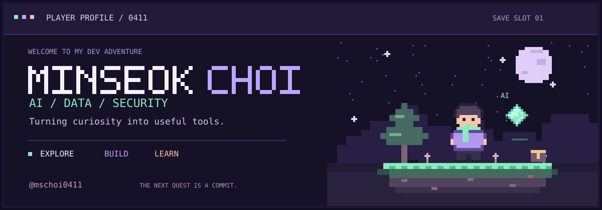

  

<h3 align="center">작은 호기심을, 실제로 쓸 수 있는 도구로.</h3>

  AI와 데이터 분석을 탐구하고, 웹과 데스크톱 도구를 만들고 있습니다. 
  보안과 게임 개발에도 관심이 있는 개발자 최민석입니다.

  <a href="#player-card">PLAYER</a> ·
  <a href="#inventory">INVENTORY</a> ·
  <a href="#quest-log">QUESTS</a> ·
  <a href="#next-stage">NEXT STAGE</a>

---

## 🧑‍💻 01 · PLAYER CARD

| 슬롯 | 소개 |
| :--- | :--- |
| **Player** | 최민석 · Minseok Choi |
| **Base camp** | 광운대학교 정보융합학부 |
| **Main interests** | AI · 데이터 분석 · 보안 |
| **Side quests** | 웹·앱 개발 · 게임 개발 · 자동화 도구 |
| **Play style** | 문제를 발견하고, 직접 만들며 배우기 |

## 🎒 02 · INVENTORY

공개 프로젝트에서 사용한 도구와 기술입니다.

| 장비 | 기술 |
| :--- | :--- |
| **Languages** | `Python` · `JavaScript` |
| **Web** | `Node.js` · `Express` |
| **Desktop & Vision** | `PySide6` · `OpenCV` · `Tesseract OCR` |
| **Quality & Packaging** | `pytest` · `Ruff` · `mypy` · `PyInstaller` |

## 🗺️ 03 · QUEST LOG

### 🔮 Screen Translate Overlay

화면의 텍스트를 OCR로 읽고, 번역을 오버레이로 보여주는 Windows 데스크톱 도구.

`Python` `PySide6` `Tesseract` · **화면 인식 / 번역 / 오버레이**

[→ 퀘스트 살펴보기](https://github.com/mschoi0411/real_ocr_translator)

### 📊 UX & A/B Experiment Lab

사용자 이벤트 수집부터 실험 관리, 지표 대시보드, 비주얼 에디터와 챗봇까지 탐구하는 샘플 앱.

`JavaScript` `Node.js` `Express` · **행동 분석 / A/B 실험 / AI 활용**

[→ 퀘스트 살펴보기](https://github.com/mschoi0411/test_ux)

### 🎙️ VoiceForge AI

오프라인 실시간 음성변조를 목표로 개발 중인 프로젝트. 현재 초기 구조를 구축한 단계입니다.

`Python` · **실시간 오디오 / DSP / ONNX 모델 연동 계획**

[→ 퀘스트 살펴보기](https://github.com/mschoi0411/voiceforge-ai)

<b>🏆 Achievement unlocked · 첫 번째 대회 우승</b>

광운대학교 창의설계입문 대회 1위 팀 프로젝트 자료입니다.

[→ Traffic Protectors](https://github.com/mschoi0411/traffic-protectors)

## 🌱 04 · NEXT STAGE

- **AI & Data** — 데이터를 해석하고, 실제 서비스에 연결하는 방법 탐구
- **Security** — 시스템의 동작 원리와 취약점을 이해하는 공부
- **Game Dev** — AI를 활용한 게임과 상호작용 실험

 

  

<!-- Profile visuals are self-contained SVGs in assets/. Edit this README to update the quest log. -->
