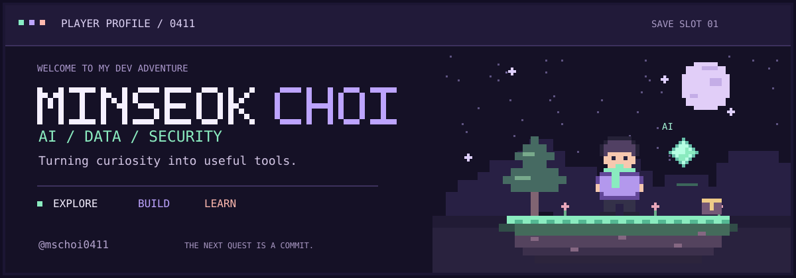

  

<h3 align="center">Turning curiosity into useful tools.</h3>

  I'm Minseok, a developer exploring AI and data analysis through web and desktop projects. 
  My side quests include security, game development, and automation.

  <a href="#player-card">PLAYER</a> ·
  <a href="#inventory">INVENTORY</a> ·
  <a href="#quest-log">QUESTS</a> ·
  <a href="#next-stage">NEXT STAGE</a>

---

## 🧑‍💻 01 · PLAYER CARD

| Slot | Details |
| :--- | :--- |
| **Player** | Minseok Choi |
| **Main interests** | AI · Data Analysis · Security |
| **Side quests** | Web & App Development · Game Development · Automation |
| **Play style** | Find a problem. Build a solution. Learn along the way. |

## 🎒 02 · INVENTORY

Tools and technologies used across my public projects.

| Equipment | Technologies |
| :--- | :--- |
| **Languages** | `Python` · `Java` · `JavaScript` · `TypeScript` |
| **Frontend** | `React` · `Next.js` · `Vite` |
| **Backend** | `Node.js` · `Express` · `FastAPI` · `NestJS` |
| **Database & ORM** | `MySQL` · `Prisma` |
| **Mobile** | `Android` · `AndroidX` · `Material Components` |
| **Desktop & Vision** | `PySide6` · `OpenCV` · `Tesseract OCR` |
| **AI & Visualization** | `OpenAI API` · `Chart.js` |
| **Bots & Audio** | `discord.py` · `edge-tts` · `yt-dlp` |
| **Dev Tools** | `Git` · `Docker` · `Gradle` · `ESLint` |
| **Quality & Packaging** | `pytest` · `Ruff` · `mypy` · `PyInstaller` |

## 🗺️ 03 · QUEST LOG

### 🔮 Screen Translate Overlay

A Windows desktop tool that reads on-screen text with OCR and displays translations in an overlay.

`Python` `PySide6` `Tesseract` · **Screen OCR / Translation / Overlays**

[→ Explore the quest](https://github.com/mschoi0411/real_ocr_translator)

### 📊 UX-Stream Dashboard

A capstone team project that collects user behavior through a browser SDK and analyzes UX through a real-time Kafka and Redis pipeline.

Connects session journeys and drop-off analysis with AI insights, a Visual Editor for UI improvements, and A/B testing to evaluate changes.

`JavaScript` `Node.js` `Kafka` `Redis` · **Real-time UX Analytics / AI Insights / UI Improvements / A/B Testing**

[→ Dashboard quest](https://github.com/Legend-Capstone-Design-26/Dashboard) · [Browser SDK](https://github.com/Legend-Capstone-Design-26/UX_SDK) · [Ecommerce demo](https://github.com/Legend-Capstone-Design-26/Ecommerce)

### 🎙️ VoiceForge AI

An offline, real-time voice changer in early development. The initial project scaffold is in place.

`Python` · **Real-time Audio / DSP / Planned ONNX Integration**

[→ Explore the quest](https://github.com/mschoi0411/voiceforge-ai)

<b>🏆 Achievement unlocked · First Competition Win</b>

Team project materials from our first-place entry in Kwangwoon University's Introduction to Creative Design competition.

[→ Traffic Protectors](https://github.com/mschoi0411/traffic-protectors)

## 🌱 04 · NEXT STAGE

- **AI & Data** — Explore how to turn data into insights and working services
- **Security** — Study how systems work and where vulnerabilities arise
- **Game Dev** — Experiment with AI-powered games and interactive experiences

 

  

<!-- Profile visuals are self-contained SVGs in assets/. Edit this README to update the quest log. -->
